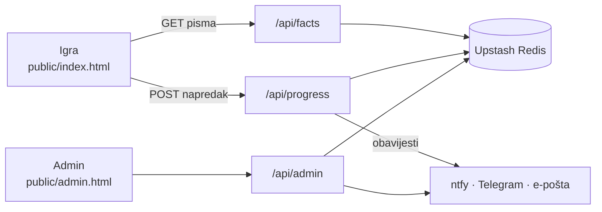

# Jesi znala?

[](https://github.com/amarjanovicc/jesi-znala/releases) [](https://github.com/amarjanovicc/jesi-znala/actions/workflows/ci.yml)

Dnevna igra znanja u obliku pisma: svaki dan stigne jedno **pismo s kratkom pričom** iz povijesti, antike ili informatike, a nakon njega tri pitanja. Točno riješeno pismo postaje **marka u albumu**, a napredak se bilježi u **putovnici** s činovima i vizama. Uz igru dolazi **admin** za pisanje pisama i praćenje napretka te **obavijesti** kad igrač uđe u igru ili odigra pismo.

*A daily knowledge game built as letters: one short story a day (history, antiquity, tech), three questions, a stamp album and a passport with ranks. Includes a password-protected admin and push notifications. Vanilla JS front end, Vercel serverless functions, Upstash Redis.*

**Igra:** <https://jesi-znala.vercel.app> · **Admin:** `/admin.html` (zaštićen lozinkom)

---

## Sadržaj

- [Što igra radi](#što-igra-radi)
- [Admin i obavijesti](#admin-i-obavijesti)
- [Kako je izgrađeno](#kako-je-izgrađeno)
- [Struktura projekta](#struktura-projekta)
- [Postavljanje](#postavljanje)
- [Pisma: sadržaj i format](#pisma-sadržaj-i-format)
- [Bodovi i činovi](#bodovi-i-činovi)
- [API](#api)
- [Sigurnost i privatnost](#sigurnost-i-privatnost)
- [Razvoj](#razvoj)
- [Objava i izdanja](#objava-i-izdanja)
- [Poznata ograničenja](#poznata-ograničenja)

---

## Što igra radi

| Dio | Opis |
|---|---|
| **Pismo dana** | Jedno pismo se otključava svaki dan, od datuma `START`. Omotnica na početnom zaslonu nosi pitanje kao mamac, a pismo se otvara animacijom noža za pisma (uz zvuk). |
| **Tri pitanja** | Prvo pitanje dolazi prije priče: odabir odgovora ili procjena broja klizačem. Nakon čitanja slijede dva pitanja za provjeru. |
| **Album** | Svako riješeno pismo je marka s brojkom koja se pamti iz priče (npr. `1699`, `4 km`), obojena po kategoriji i s poštanskim žigom i rezultatom. |
| **Putovnica** | Bodovi, putnički čin i vize (žigovi za postignuća) na jednoj kartici. Vidi [Bodovi i činovi](#bodovi-i-činovi). |
| **Ponavljanje** | Riješena pisma vraćaju se s jednim pitanjem nakon 2, 5 i 12 dana. Nakon trećeg točnog odgovora pismo je „zapamćeno". |
| **Nedjeljna razglednica** | Nedjeljom pet pitanja iz cijelog albuma. |
| **Reakcije i poruke** | Nakon pisma može se dati reakcija i napisati kratka poruka koja stiže adminu. |
| **Ukus** | Srce „sviđa mi se" na pismima, označena područja interesa i prijedlozi tema; admin vidi što voli i dobiva obavijest. |
| **Serija** | Dani zaredom s barem jednim odigranim pismom; prikazuje se na početnom ekranu, u putovnici (najdulja serija) i na ljestvici lige. Živa je ako je zadnji dan danas ili jučer. |
| **Liga** | Privatna soba za do 8 ljudi s pozivnim kodom (6 znakova) ili linkom `/#liga=KOD`. Bez računa: vidi se samo nadimak, bodovi tjedna, serija i čin. Tjedan teče od ponedjeljka do nedjelje (pismo 2 boda, čisti žig +1, razglednica +1 po točnom), a ljestvica pokazuje i pobjednika prošlog tjedna. Do 3 lige po igraču, do 30 liga ukupno. |
| **Podsjetnik** | Web push jednom dnevno oko 18 sati, samo ako je uključen i toga dana još nije otvoreno pismo; tekst spominje seriju u opasnosti. Na iPhoneu radi tek kad je igra dodana na početni zaslon. |
| **Uređaji i sinkronizacija** | Svaki mobitel dobije anonimni ID bez prijave. Napredak se čuva na serveru i vraća ako preglednik obriše podatke; uređaje se može spojiti kodom u linku. |
| **Offline** | Aplikacija se može dodati na početni zaslon i radi bez interneta (service worker). |

Tri kategorije pisama: **Povijest**, **Antika** i **Informatika** (kôd podržava i Geografiju).

## Admin i obavijesti

Na `/admin.html`, uz lozinku:

- **Pregled:** stanje, popis „za napraviti", zadnja aktivnost i poruke igrača.
- **Pisma:** tablica s pretragom i filtrom, uređivač s pregledom uživo, sigurnosna kopija i povratak na prethodnu verziju.
- **Igrači:** stvaranje linka za novog igrača, link za praćenje samo za pregled, čin i bodovi, reakcije i poruke.
- **Obavijesti:** stanje kanala, stanje podsjetnika igraču i probna poruka.
- **Pregled** prikazuje i sve lige (kod, članovi, bodovi tjedna) uz brisanje lige; u detaljima igrača je gumb za probni podsjetnik.
- **Izvoz:** sva pisma i napredak igrača kao JSON (bez tajnih kodova).

Obavijest stiže kad povezani igrač **uđe u igru** (najviše jednom u 30 minuta), **odigra pismo ili nedjeljnu razglednicu**, **napiše poruku ili reakciju** ili **dobije novi čin**. Podržani su kanali [ntfy](https://ntfy.sh), Telegram i e-pošta (Resend); dovoljan je jedan.

## Kako je izgrađeno

Bez frameworka i bez build koraka za front end: igra je jedna HTML datoteka s ugrađenim CSS-om i JavaScriptom, a backend su tri Vercel funkcije.



- **Front end:** vanilla JavaScript, SVG i CSS; zvukovi se sintetiziraju u pregledniku (Web Audio), bez datoteka. Fontovi se učitavaju u pozadini s Google Fontsa.
- **Backend:** Node.js funkcije (`api/`), bez vanjskih paketa.
- **Baza:** [Upstash Redis](https://upstash.com) preko REST sučelja (besplatni plan je dovoljan).
- **Hosting:** [Vercel](https://vercel.com).
- **Izvor igre:** `src/jesi-znala.html`; skripta `src/build.py` iz njega slaže `public/` i `data/`.

## Struktura projekta

```text
.
├── src/
│   ├── jesi-znala.html     IZVOR igre: izgled, pravila, početna pisma
│   └── build.py            iz izvora slaže public/ i data/
├── public/                 ono što vide posjetitelji
│   ├── index.html          igra (generira se)
│   ├── admin.html          admin (piše se ručno)
│   ├── sw.js, manifest…    offline rad i ikona (generira se)
├── api/                    Vercel funkcije
│   ├── facts.js            popis pisama (iz baze, a bez nje iz data/facts.json)
│   ├── progress.js         sinkronizacija, praćenje, obavijesti
│   ├── admin.js            admin API (zaštićen lozinkom)
│   └── _lib.js             zajednički kôd (provjere, spajanje stanja, činovi, obavijesti)
├── data/                   facts.json i config.json (generira se iz src/)
├── vercel.json             zaglavlja (uključujući zaštitu admina)
├── .env.example            popis varijabli okoline
└── package.json            skripte
```

Datoteke u `public/` (osim `admin.html`) i u `data/` su **generirane**: mijenja se `src/jesi-znala.html`, a zatim `npm run site`.

## Postavljanje

Potrebno: [Node.js](https://nodejs.org) 20+, Python 3, Vercel račun i Vercel CLI (`npx vercel`).

**1. Preuzimanje i povezivanje s Vercelom**

```bash
git clone https://github.com/amarjanovicc/jesi-znala.git
cd jesi-znala
npx vercel link
```

**2. Baza.** U Vercelu: projekt → **Storage** → **Create Database** → **Upstash for Redis** → povezati s projektom. Varijable `KV_REST_API_URL` i `KV_REST_API_TOKEN` dodaju se same.

**3. Varijable okoline.** Dodaju se naredbom `npx vercel env add IME production`, a vrijednost se upisuje na upit.

| Varijabla | Obavezna | Opis |
|---|---|---|
| `ADMIN_PASSWORD` | da, za admin | Lozinka za `/admin.html` (preporuka: barem 12 znakova). Bez nje admin odbija prijavu. |
| `KV_REST_API_URL`, `KV_REST_API_TOKEN` | da, za sinkronizaciju i admin | Dodaje ih Upstash integracija. Podržani su i `UPSTASH_REDIS_REST_URL` / `UPSTASH_REDIS_REST_TOKEN`. |
| `NTFY_TOPIC` | jedan kanal | Tajni naziv ntfy teme. Pretplati se na isti naziv u aplikaciji ntfy. |
| `NTFY_SERVER` | ne | Zadano `https://ntfy.sh`. |
| `TELEGRAM_BOT_TOKEN`, `TELEGRAM_CHAT_ID` | jedan kanal | Obavijesti preko Telegram bota. |
| `RESEND_API_KEY`, `NOTIFY_EMAIL` | jedan kanal | Obavijesti e-poštom preko Resenda. |

Tajne se **nikad** ne stavljaju u kod ni u Git; vidi `.env.example`.

**4. Objava.** Najlakše je povezati Vercel s GitHub repozitorijem (`npx vercel git connect`), pa se svaki push na `main` objavljuje sam. Ručno se objavljuje s `npx vercel deploy --prod`. Vidi [Objava i izdanja](#objava-i-izdanja).

Nakon dodavanja ili promjene varijabli treba nova objava. Bez baze igra i dalje radi, ali bez sinkronizacije, admina i obavijesti.

## Pisma: sadržaj i format

Pisma se mogu pisati u **adminu** (sprema se u bazu) ili u izvoru (`FACTS` u `src/jesi-znala.html`). Čim admin spremi prvu izmjenu, igra čita pisma iz baze.

- Pisma se **mogu uređivati i dodavati, ali ne brisati**: napredak igrača vezan je uz redni broj pisma.
- Jedno se pismo otključava svaki dan, računajući od konstante `START` u izvoru.

Primjer pisma:

```js
{
  cat: 'ant',                 // pov | ant | inf (i geo)
  title: 'Carstvo na dražbi', // naslov, do 80 znakova
  fig: '66', figu: 'dana',    // broj i jedinica na marki
  q: 'Koliko je dana vladao car koji je 193. kupio prijestolje?',
  num: { min: 1, max: 365, step: 1, a: 66, tol: 10, unit: ' dana', du: ' dana' },
  // ili izbor odgovora umjesto num:  opts: ['A', 'B', 'C'], a: 0
  story: 'Kratka priča, 60 do 100 riječi…',
  quiz: [
    { q: 'Prvo pitanje za provjeru?',  opts: ['Točno', 'Netočno', 'Netočno'], a: 0 },
    { q: 'Drugo pitanje za provjeru?', opts: ['Točno', 'Netočno'],            a: 0 }
  ],
  note: 'Neobavezna osobna poruka rukopisom'
}
```

Svako pismo ima točno dva pitanja za provjeru, a svako pitanje 2 do 4 odgovora. Poslužitelj provjerava sve prije spremanja, a tekst se u igri prikazuje kao običan tekst, ne kao HTML.

## Bodovi i činovi

Bodovi: **pismo 2**, **čisti žig (3/3) +1**, **zapamćeno pismo +2**. Popis činova nalazi se u `src/jesi-znala.html` (`RANKS`), a build ga prepisuje u `data/config.json` pa isti čin vide igra, admin i obavijesti.

| Bodovi | Čin |
|---:|---|
| 0 | Turistkinja |
| 10 | Putnica |
| 25 | Istraživačica |
| 45 | Pustolovka |
| 70 | Navigatorica |
| 100 | Kartografkinja |
| 135 | Veleposlanica |
| 170 | Građanka svijeta |

## API

| Ruta | Metoda | Pristup | Opis |
|---|---|---|---|
| `/api/facts` | GET | javno | Popis svih pisama. |
| `/api/progress` | POST | kod u tijelu zahtjeva, zaglavlje `X-JZ`, ista adresa | Sprema i spaja napredak, zabilježi posjet, šalje obavijesti. |
| `/api/progress?code=…` | GET | kod | Provjera postoji li kod. |
| `/api/progress?watch=…` | GET | kod za praćenje | Sažetak napretka samo za čitanje. |
| `/api/admin?action=login` | POST | lozinka | Vraća token koji vrijedi 12 sati. |
| `/api/admin?action=…` | GET/POST | token | `status`, `letters`, `saveLetters`, `restoreLetters`, `players`, `player`, `createPlayer`, `labelPlayer`, `deletePlayer`, `resetToday`, `leagues`, `deleteLeague`, `testPush`, `testNotify`, `export`. |
| `/api/league` | POST | kod uređaja, zaglavlje `X-JZ`, ista adresa | `mine`, `create`, `join`, `leave`; vraća ljestvice liga tog uređaja. |
| `/api/push` | GET/POST | ovisno | `?key=1` javni VAPID ključ, `POST` sprema ili briše pretplatu uređaja, `?msg=1` tekst obavijesti (prepoznaje uređaj po kolačiću), `?cron=1` dnevni cron (radi samo navečer i najviše jednom dnevno po uređaju). |

## Sigurnost i privatnost

- **Bez računa:** igrači nemaju račune ni lozinke. Pristup napretku daje dugi nasumični kod (16 znakova) u linku `/#sync=…`; poseban kod `/#watch=…` daje samo pregled.
- **Admin:** lozinka se uspoređuje u konstantnom vremenu, token je potpisan (HMAC) i istječe nakon 12 sati, a prijava je ograničena na 8 pokušaja u 15 minuta po IP adresi. Stranica ima `noindex`, `X-Frame-Options: DENY` i Content-Security-Policy.
- **Anonimni ID uređaja:** pri prvom otvaranju igra sama napravi nasumični ID, sprema ga u `localStorage` i u kolačić `jz_id` (2 godine). Ako preglednik obriše podatke, a kolačić ostane, napredak se vrati sa servera; ako obriše i kolačić, uređaj počinje kao novi. Server uz napredak pamti samo vrstu uređaja (npr. iPhone, Android), ništa osobno.
- **Zaštita od zlouporabe:** ulaz za sinkronizaciju je javan pa prima samo zahtjeve iz same igre (posebno zaglavlje, ista adresa), do 40 KB, najviše 100 uređaja ukupno i 10 novih na sat po IP adresi; sve što dolazi od klijenta čisti se i ograničava prije spremanja.
- **Podaci:** poslužitelj sprema samo napredak, oznaku igrača, reakcije i poruke te vrijeme zadnjeg ulaska. Obavijesti idu na kanal koji sam postaviš; tema na ntfy je tajna samo dok je nitko ne zna, pa neka bude duga i nasumična.
- **Sigurnosne kopije:** admin → Pregled → *Preuzmi kopiju*. Izvoz ne sadrži tajne kodove.

## Razvoj

```bash
npm run site        # python3 src/build.py: slaže public/ i data/ iz izvora
npm run deploy      # build + vercel deploy --prod
```

- Nakon izmjene izvora uvijek pokreni `npm run site` i spremi i generirane datoteke.
- Funkcije se lokalno mogu pokrenuti s `npx vercel dev` (potrebna je povezana baza i varijable okoline).
- Skripta `build.py` koristi Node.js za čitanje popisa pisama i činova iz izvora.

## Objava i izdanja

- **Produkcija:** svaki push na `main` Vercel objavljuje na <https://jesi-znala.vercel.app>.
- **Pregledi:** svaki pull request dobiva vlastitu pregled objavu (preview) s posebnim linkom.
- **Provjera:** GitHub Actions (`.github/workflows/ci.yml`) pokreće se na svakom pushu i pull requestu.
- **Izdanja:** svako izdanje je oznaka oblika `vX.Y.Z` i GitHub *release* s opisom; popis promjena je u [CHANGELOG.md](CHANGELOG.md).

Novo izdanje:

```bash
# 1. dopuni CHANGELOG.md i povećaj "version" u package.json
git commit -am "Izdanje 1.1.0"
git tag v1.1.0
git push origin main --tags
gh release create v1.1.0 --title "v1.1.0" --notes-file <(sed -n '/^## \[1.1.0\]/,/^## \[/p' CHANGELOG.md | sed '$d')
```

## Poznata ograničenja

- **Testovi pokrivaju samo API** (`npm test`: liga, serija, podsjetnik, admin, s lažnim Redisom i push servisom). Ponašanje zaslona i stvarna isporuka push obavijesti provjereni su ručno.
- **Podsjetnik traži postavljanje:** ključevi se naprave naredbom `node scripts/vapid.js`, a `VAPID_PUBLIC_KEY`, `VAPID_PRIVATE_KEY` i `VAPID_SUBJECT` upisuju se u Vercel (nikad u Git). Cron je jednom dnevno (Vercel Hobby), pa vrijeme nije točno na minutu. Obavijest nema sadržaj u samoj poruci: servis worker tekst dohvaća sa servera.
- **Pisma su javna:** `/api/facts` vraća sva pisma odjednom, uključujući ona koja se tek trebaju otključati. Datum otključavanja kontrolira samo front end.
- **Bez računa znači ograničen oporavak:** napredak se vraća dok postoji kolačić ili link za sinkronizaciju; kad nestanu oba, uređaj je za sustav novi.
- **Redni broj je ključ:** pisma se ne mogu brisati ni premještati bez gubitka napretka.
- **Licenca:** [MIT](LICENSE). Kôd smiješ koristiti i mijenjati; sadržaj pisama je moj tekst, pa ga nemoj kopirati bez navođenja izvora.
